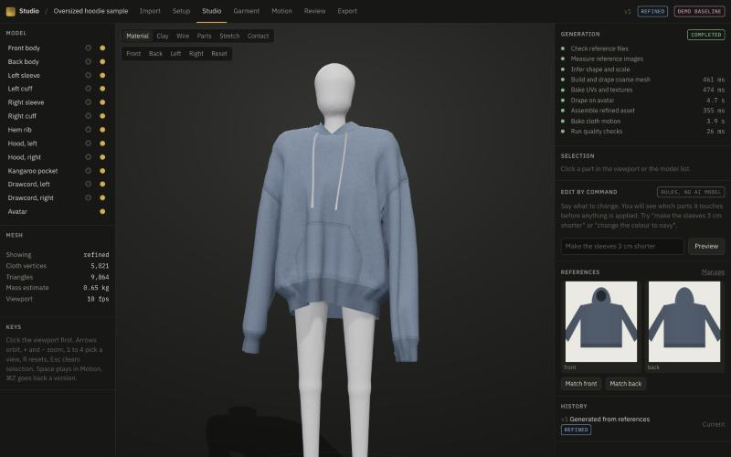

# AI 3D Studio

A browser-only studio that turns hoodie reference images into editable 3D garments, drapes them on an animated avatar with cloth simulation, and exports validated GLB and OBJ files. There is nothing to install and no server. Your files stay on your device.

**Current status: a working garment vertical slice, labelled DEMO BASELINE.** It uses classical image measurement and a parametric pattern. No AI model is connected, and no export has been opened in Blender. See [What is real](#what-is-real-mocked-and-unverified).



## Open it

Hosted private link: https://claude.ai/artifact/MtDKxvFf9H7sEips5AnpNy. Only the owner can open it until it is shared from its Share menu. It has not been tested inside the hosted frame yet, because the test browser was not signed in.

To run it from this folder:

```bash
bun install
```

```bash
bun run dev
```

Then open http://localhost:5183. Any browser with WebGL 2, Web Workers, IndexedDB and OffscreenCanvas should work. Only the Chromium-based browser pane in the Claude desktop app has been tested.

`bun run build` writes a static site to `dist/`. Any static host can serve it. It does not run from a `file://` address, because browsers block module workers there.

## Use it

1. **Library:** create a project.
2. **Import:** drop a front photo and optionally a back photo on a plain background, or press **Try the sample hoodie**. Add measurements if you have them.
3. **Setup:** see which values were measured, inferred or assumed, then generate.
4. **Studio:** a coarse mesh appears in under a second. Orbit it while it refines.
5. **Garment:** edit dimensions, fabric, colour, pins and avatar, and inspect seams and the flat pattern.
6. **Motion:** bake and scrub walk, jog, arm lift or idle.
7. **Review:** compare against your references, read the checks, restore versions, approve.
8. **Export:** download a ZIP with GLB or OBJ and a validation report.

Edit commands such as "make the sleeves 3 cm shorter" show which parts change before anything is applied. Each edit makes a new version, and any earlier version can be restored.

## What is real, mocked and unverified

| Area | Status | What that means |
|---|---|---|
| 3D geometry, seams, UVs, textures | **Works, tested** | Real mesh with 12 named parts and 16 to 18 structural seams, depending on parts present |
| Cloth simulation | **Works, tested** | XPBD solver with gravity, stretch, bend, avatar collision and particle self-collision. Baked ahead of time in a Web Worker, then played back |
| Image reading | **Baseline, tested on synthetic images only** | Classical outline measurement. Not tested on real photographs |
| "AI" generation | **Not connected** | Output is a template fitted to measurements, labelled DEMO BASELINE everywhere |
| Edit commands | **Rule-based** | A fixed command parser. No language model. It refuses what it cannot do |
| GLB, OBJ | **Validated, not opened in a 3D app** | GLB passes the Khronos glTF Validator and an independent parser. OBJ passes a line parser |
| Real `.blend` file | **Not delivered** | Only Blender can write one. The owner chose browser-only with no Blender download, on 2026-11-05 |
| "For Blender" package | **Untested** | The same GLB plus a script to run in your own Blender. It has never been run |
| Viewport frame rate | **Not measured** | The test pane was hidden and throttled, so its readings are not valid |
| Hosted link | **Published, not tested in its frame** | The same build passed locally in the browser |
| Reduced-motion support | **Coded, not exercised** | No automatic motion runs, and CSS animation is disabled by the media query |

## Supported inputs and outputs

- **Used:** PNG and JPEG, front and back views, up to 30 MB and 40 megapixels. Measurements for body length, chest width and sleeve length.
- **Stored but not used yet:** MP4, MOV, PDF, GLB, OBJ, TXT.
- **Rejected:** WebP, HEIC, GIF, and anything whose bytes do not match a known type.
- **Output:** GLB with skinned avatar, skeletal clips and baked cloth as morph targets. OBJ static with MTL and texture. See [docs/QUALITY.md](docs/QUALITY.md).

## Costs

$0 to run. All compute happens on the user's device, and no paid service is used. See [docs/RISKS_AND_ROADMAP.md](docs/RISKS_AND_ROADMAP.md).

## Develop

```bash
bun run test
```

```bash
bun run build
```

```bash
bun run benchmark
```

```bash
bun run examples
```

Layout:

| Path | Purpose |
|---|---|
| `src/core` | Geometry, avatar, cloth solver, GLB and OBJ writers, image analysis, edits, checks. No platform code |
| `src/engine` | Projects, durable jobs, pipeline stages, validators, provider contract |
| `src/web` | React UI, three.js viewport, browser platform (IndexedDB, Workers, canvas) |
| `tests` | 58 tests that run the same engine headless in Bun |
| `fixtures` | Synthetic test images with known proportions, and deliberately bad files |
| `examples` | Sample exports and validation reports |
| `docs` | Specification, decisions, architecture, quality evidence, risks, research |

## Troubleshooting

- **"The studio is open in another tab":** only one tab can work on projects at a time. Close the other tab, then reload.
- **"Storage is blocked":** a private window may block IndexedDB. Work still runs, but it is lost when the tab closes.
- **A job says interrupted:** the tab closed during a run. Press Resume. Finished stages are reused.
- **Outline is wrong:** use a plain background with the whole garment in frame, or correct the values in the Garment tab.
- **Projects disappeared:** clearing this site's browser data deletes them. Projects are not backed up anywhere else.

## Handoff documents

[Specification](docs/SPEC.md) · [Decision register](docs/DECISIONS.md) · [Screens](docs/SCREENS.md) · [Architecture](docs/ARCHITECTURE.md) · [Quality evidence](docs/QUALITY.md) · [Risks and roadmap](docs/RISKS_AND_ROADMAP.md) · [Specialist research](docs/research)
