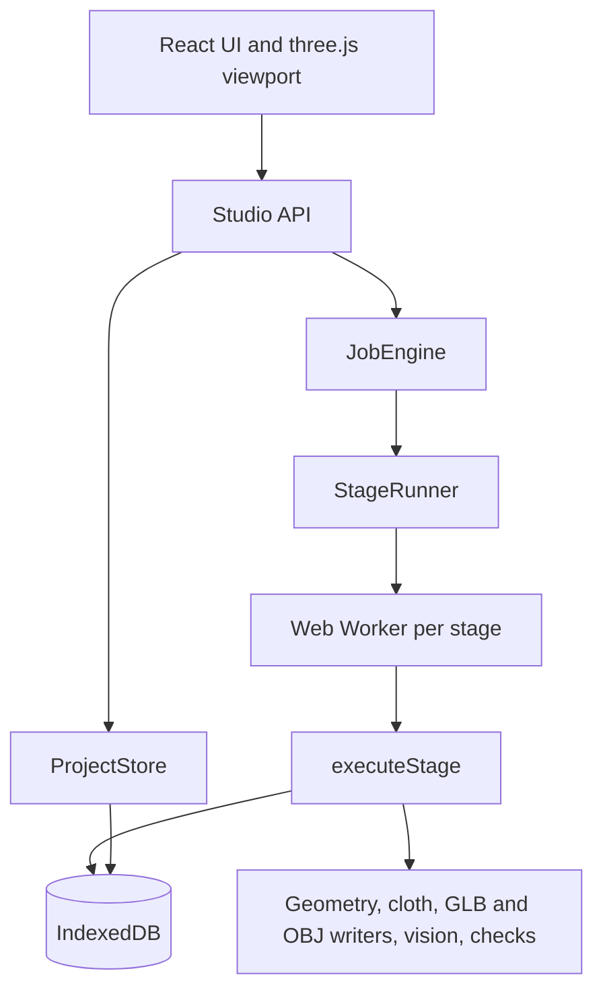

# Architecture



## Pipeline

| Stage | Output | Reused when |
|---|---|---|
| Upload check | Byte-sniffed type, size and pixel limits, SHA-256 | Same hash |
| Analyze, in a Worker | Outline mask, ratios, colours, confidence, warnings | Same image hash |
| Infer | Parameters, with a source and note for each | Always recomputed, it is instant |
| Coarse | Draped low-resolution GLB, tier **draft** | Same geometry, fabric, colour, avatar, seed, pins |
| Texture | Base colour and normal atlas, source per part | Same layout, colours, fabric, quality, images |
| Drape | Solver positions, velocities, diagnostics | Same geometry, physical fabric, quality, avatar, seed, pins |
| Refined | Final GLB, scene data, heatmap, tier **refined** | Same inputs |
| Motion | Baked frames | Same drape and clip |
| QA | Checks | Same drape and clip |
| Export and validate | File, report, tier **validated** | Same inputs |

Colour never enters the physics key, so a colour edit reuses the drape. That is tested.

## Contracts

```ts
interface Storage {
  read(path): Promise<Uint8Array | null>;
  writeMany(entries): Promise<void>;   // all or nothing
  exists(path); list(prefix); removePrefix(prefix);
}
interface StageRunner { start(task, onProgress): { done: Promise<void>; kill(): void } }
interface ImageCodec { decode(bytes, kind); encodeJpeg(img, quality); encodePng(img) }
interface ReconstructionProvider { id; label; kind: 'baseline' | 'ai'; status; note; available() }
```

A real provider plugs in at `src/engine/providers.ts`. `remote-ai` exists only to prove the fallback path. It makes no call, because no vendor is connected. Research recommends the Tripo API first for surfaces, then GarmentCode with AIpparel on a rented GPU for editable patterns. Neither has been tested, and any API or GPU use needs owner approval, a server component to hold the key, and a change to the browser-only decision.

## Job states

`queued → running → completed | failed | cancelled`. A job found running when the page opens becomes `interrupted`. Retry and resume re-run the job, and stages with stored output are reused by content key. All of a stage's output is written in one transaction, so a killed stage leaves nothing behind.

## Garment model

- **Simulation mesh:** one welded surface. Seams are vertex merges in the topology.
- **Appearance parts:** 12 named meshes that share simulation vertices, so normals stay smooth across seams.
- **Embedded parts:** pocket and drawcords follow the front panel and are not simulated. The cords do not swing.
- **Avatar:** a skeleton of 19 joints. The visible mesh comes from a smooth distance field and sits slightly inside the capsule colliders.
- **Bending** uses unfolded rest distance, so fabric has no memory of its cut shape.
- **Units** are metres, +Y up, +Z front.

## Security and privacy

- No server, no accounts, no network calls beyond loading the app. Observed: every resource request went to the app's own origin.
- Uploads are checked by bytes, with size and dimension limits read before decoding. Decoding happens in a Worker using the browser's image code.
- 3D, video and PDF uploads are stored and never parsed.
- There are no secrets in the bundle, because there are none in the product.
- Uploaded designs are not sent anywhere or used for training. Attribution: the avatar, motions and fixtures are original to this project.
- Before any multi-user or hosted-compute version, `research/backend-security.md` lists what must be added.
