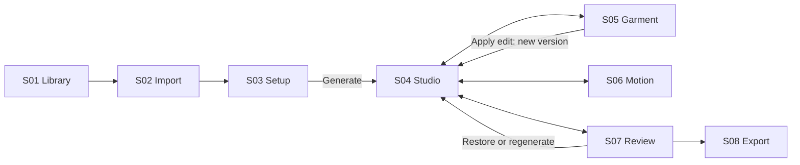

# Screens and flow

The 3D viewport, model list and selection persist across S04 to S08.

| ID | Screen | What it does | States built |
|---|---|---|---|
| S01 | Library | Create, open, resume, rename, duplicate, delete with confirmation | Empty, loading, failed, success. Shows interrupted, failed and running jobs |
| S02 | Import | Drag and drop, camera view per image, outline preview on hover, measurements, format table, privacy note, sample button | Empty, checking files, per-file errors, partial success |
| S03 | Setup | Each value's source and basis, warnings, quality, avatar, motion, generator, measured time, cost | No image, contradictory references, provider unavailable |
| S04 | Studio | Orbit, pan, zoom, views, display modes, layers, isolate, selection, status, edit commands, references, history | No mesh, building, draft while refining, refined, load failed, failed with retry, interrupted with resume |
| S05 | Garment | Dimension sliders with source labels, fabric, colour, pocket, cords, change preview, avatar, pins, contact and stretch, flat pattern, seam list and overlay | No version, unsaved change, refused change |
| S06 | Motion | Clips with bake or load, play, pause, scrub, speed, collision numbers. Shows that playback is baked | Not baked, baking with real frame counts, loaded, static drape |
| S07 | Review | Matched-view render against references, outline overlap, checks, inferred list, edit locality, regenerate, history, approval | No references, no checks yet, passed, warned |
| S08 | Export | Format choice, motion, units and orientation, ZIP download, per-validator results, report, format table | Not exported, passed, unverified, failed |

App-level states: starting, open in another tab, storage blocked, WebGL unavailable, unexpected error with reload.

## Evidence

- [Setup with source labels](evidence/setup-provenance.jpg)
- [Edit with parts shown before applying](evidence/edit-scope.jpg)
- [Studio](evidence/studio-screen.jpg)
- [Walking, mid-stride](evidence/motion-walk.jpg)
- [Close view of the garment](evidence/front-close.png)

## Accessibility

Critical viewport actions have non-canvas controls: camera buttons, model list for selection, isolate and hide, a scrub slider and a play button. The canvas is focusable and takes arrow keys, plus and minus, 1 to 4, R and Esc. Tested in the browser: orbit, zoom, front view, reset, hide, isolate and select. Not tested: a screen reader, or a full keyboard-only journey.

There is no fake progress. The status panel names the actual stage and shows real simulated frame counts.
